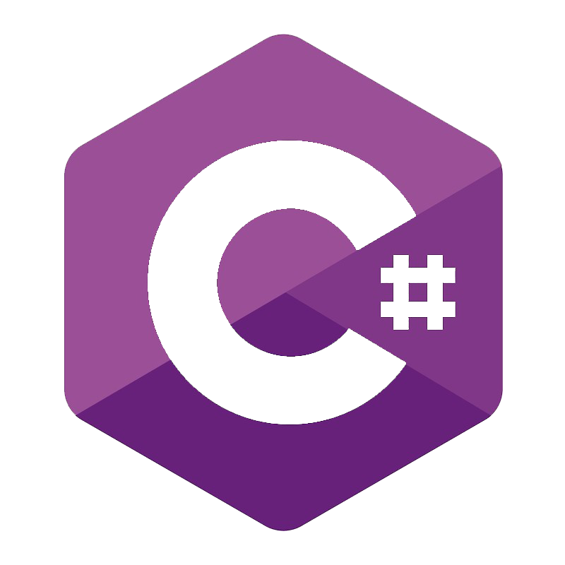
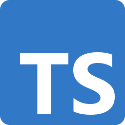

<h1 align="center">Olá, eu sou o Gustavo!</h1>
<h3 align="center">E eu adoro trabalhar com solução de problemas</h3>

- 📚 Formado em Ciências Exatas pela UFJF, e graduando em **Ciência da Computação** pela mesma universidade.
- 🌱 Estudo e pratico **Desenvolvimento Fullstack** há mais de três anos
- 🖥️ Tenho foco nas linguagens: **TypeScript** e **C#** 
- 💻 E nos frameworks: **Vue** e **ASP.NET Core**
- 📫 Fale comigo através do e-mail **gus.campos042@gmail.com**

<h1 align="left">Veja meus projetos publicados:</h3>

<h2 align="left"> Reagen - Controle Fácil de Reagentes Químicos</h2>

Software em desenvolvimento com o objetivo de gerenciar estoque de reagentes químicos, permitindo adicionar, buscar, filtrar, dar saída, visualizar resumos e etc. Usa uma validação rica dos dados, garantindo que diferentes laboratórios, substâncias e tamanhos sempre serão identificados de forma inequívoca. Pode ser testado através do seguinte [deploy](https://reagen-xi.vercel.app/estoque).

<h2 align="left">Automated Playtest System - ATPS</h2>

Sistema implementado por mim em TypeScript para meu TCC em Ciências Exatas, que conta com um agente inteligente baseado em Monte Carlo Search Tree (MCTS), um sistema responsável por simular as partidas e coletar dados, e os protótipo de 5 jogos que foram massivamente simulados: Damas, Jogo da Velha, Gobblet Gobblers, Boop e Connect 4. Confira o [respositório](https://github.com/gus-campos/atps-engine/), e o meu [trabalho completo](https://tinyurl.com/tcc-gustavo-campos).

<h2 align="left">Desafios Web - Frontend Mentor</h2>

Desafios da plataforma Frontend Mentor para fortalecer fundamentos em CSS e HTML.

* [Chat App Illustration](https://github.com/gus-campos/web-challenge-chat-app/)
* [Clipboard Landing Page](https://github.com/gus-campos/web-challenge-clipboard)
* [Huddle Landing Page](https://github.com/gus-campos/web-challenge-huddle)

<h2 align="left">Xadrex em Java</h2>

Jogo de xadrez que recebe, valida e faz jogadas a partir de movimentos informados pelo terminal, incluindo movimento especiais como o roque (ou castling), ou o en pasant. Confira o [projeto](https://github.com/gus-campos/chess/).

<h2 align="left">Caça-Palavras Interativo em C#</h2>

Aplicativo de console em C# que gera caça-palavras de dimensões e quantidades de palavras arbitrárias, usando orientação a objetos e permite jogar a partir de entradas no teclado. As palavras podem ser horizontais, verticais ou diagonais, em ordem direta ou inversa. Diversos conceito de programação são aplicados aqui, de acordo com a descrição do [projeto](https://github.com/gus-campos/word-search/), junto de diagrama de classes que descreve a estrutura do programa.

<h2 align="left">Jogo 3D em JavaScript: Tanks War </h4>

Um jogo básico de guerra de tanques com três níveis, feito em JavaScript utilizando a biblioteca gráfica THREE.js, que fiz sozinho como trabalho da disciplina de Computação Gráfica na UFJF. Acesse o [repositório](https://github.com/gus-campos/tanks-war.github.io), e jogue em mobile ou PC (com WASD + SPACE) pela sua [github-page](https://gus-campos.github.io/tanks-war.github.io/src/index.html). 

<h2 align="left">Biblioteca: Dopagens </h4>

Meu primeiro projeto grande em programação: escrevi em Python ao longo de mais de 1 ano, e usei extensamente na minha pesquisa de Iniciação Científica (CNPq) para gerar estruturas moleculares, disparar otimizações, colher dados, calcular propiedades e gerar visualizações, além de automatizar diversos outros processos. Documentação disponível na descrição do projeto. Acesse o [projeto](https://github.com/gus-campos/dopagens).

<h2 align="left">Jogo em Unity com C#: Survive Between Stars </h4>

Jogo space shooter que idelizei, e criei em **C#/Unity**, com música de minha autoria, e assets adapatados por mim. Conheça o jogo na [página da Itch.io](https://gus-campos.itch.io/survive-between-stars) onde é possível jogá-lo direto do navegador no PC, e acesse o [repositório](https://github.com/gus-campos/Survive-Between-Stars) para conhecer a implementação e descobrir mais detalhes em seu README.

<h2 align="left">Simulador de currículos da minha graduação </h4>

Script básico em Python que usa leitura de arquivos de dados e orientação à objetos para representar disciplinas/cursos e currículos, de forma que eu possa analisar a melhor sequência de cursos a serem feitas na minha graduação. Acesse aqui o [repositório](https://github.com/gus-campos/curriculos). 

<h2 align="left">Análise Exploratória de Dados: Dataset MovieLens </h4>

Análise exploratória de dados sobre o dataset de avaliações de filmes do site MovieLens, utilizando **Python, Pandas, Seaborn e Matplotlib no Jupyter Lab**, onde foi explorada a natureza das avaliações, as preferências do público, e a divergência de opiniões da audiência sobre as obras. Para mais detalhes acesse o [projeto](https://github.com/gus-campos/movielens-EDA).

<h2 align="left">Conecte-se comigo:</h3>

<h3 align="left">Linguagens e Ferramentas:</h3>

 
  
  
   
    
  

  
